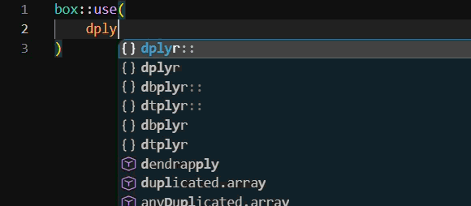
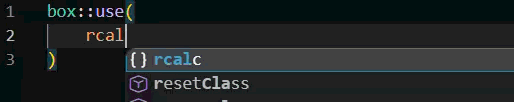
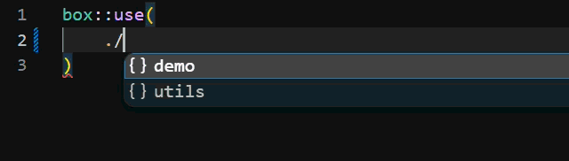
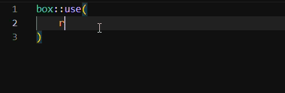
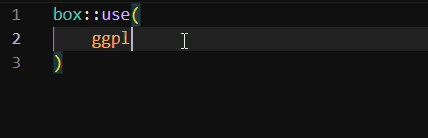

# boxpletion

  

This is an extension for type and autocompletion hints for declaring `box::use()` imports, for Positron and VS Code. It only comes with reading files, not to load or run the modules you want to import.

## Overview

Just like import completion in Python or JavaScript, `boxpletion` gives you a smarter suggestions inside `box::use()`. After you type a module or package name, or just pressing the tab, it suggests:

-  Installed CRAN-style R packages, and  

-  Globally installed [`box-bale` modules](https://baler-dev.github.io/baler/) and local modules.

After you type `/`, it suggests modules and submodules under that path (including `./` and `../`). Inside `[]`, it suggests the names the module actually exports, the same names `{box}` would expose, including names re-exported with an `@export` tag.

The GIFs below show the three main cases:

1.  Importing an entire module by name only

    a. CRAN-style R packages  

    

    b. `box-bale` modules  

    

2.  Navigating modules / submodules after `/`

    a. Local modules  

     

    b. Global `box-bale` modules 

     

3.  Attaching exported names inside `[]`

    

## Install

It has not published into Marketplace listings, yet. Until then, in order to use it, here's a suggestion:

1. Download the `.vsix` from the [latest release](https://github.com/baler-dev/boxpletion/releases/latest).
2. In Positron or VS Code, press Ctrl+Shift+P (Cmd+Shift+P on a Mac) and run **Extensions: Install from VSIX...**
3. Select the downloaded file, and reload the window when it asks.

Note: In order for this extension works for traditional R packages, one must need an [R interpreter](https://cran.r-project.org/bin/windows/base/old/) installed, then find the path where the installed interpreter is located, get the path where the binary `bin/` is installed, where `Rscript` is lived and place them to PATH, because it's run once to find your R library folders. Otherwise, if it isn't there, set `boxpletion.rscriptPath` in your user settings to its full path.

## Settings

As of now, only 1 setting is needed to be set on VS Code/Positron's settings, namely `boxpletion.rscriptPath`: path to `Rscript`, used once to find your R library folders. Default: `Rscript`.

## License

MIT + file LICENSE
